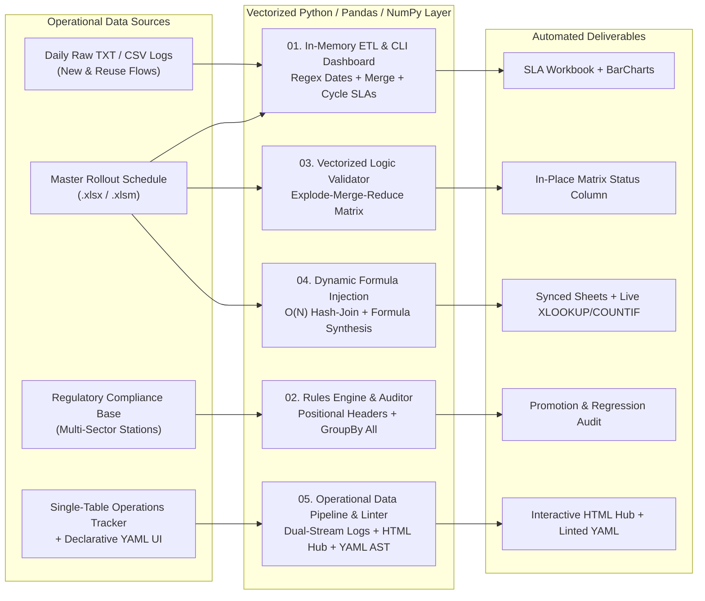

# Enterprise DataOps & Vectorized Automation Suite

> **Production-grade Python, Pandas, and NumPy data engineering pipelines** engineered to replace fragile spreadsheet workflows, manual reporting bottlenecks, and freezing legacy VBA macros with $O(N)$ in-memory processing, atomic audit rules, single-table dual-stream log orchestration, and automated Excel/HTML delivery.

[](https://www.python.org/)
[](https://pandas.pydata.org/)
[](https://numpy.org/)
[](./tests)
[](#privacy--sanitization-notice)

---

## Executive Summary & Engineering Impact

Across enterprise telecommunications and large-scale network operations, critical reporting and regulatory compliance workflows frequently suffer from desktop spreadsheet crashes, $O(N^2)$ row-deletion loops, $N+1$ relational query bottlenecks, and multi-hour manual data reconciliation. This showcase repository brings together **five fully decoupled, vectorized DataOps pipelines** designed for **Analytics Engineering**, **Data Operations (DataOps)**, and **Python Automation Engineering** workloads:

- **In-Memory ETL Architecture:** Eliminates Excel row limits and manual ingestion bottlenecks by consolidating semicolon-delimited multi-day raw logs in RAM (`pd.concat` + `pd.merge`), automating SLA cycle metrics, and emitting native `openpyxl` visual dashboards.
- **Zero Row-Level Python Loops:** Refactors legacy VBA macros and `.iterrows()` / `.apply()` code into C/Cython-backed vectorized operations (`np.select`, `np.where`, `groupby().transform('all')`, and Explode-Merge-Reduce patterns).
- **Single-Table Dual-Stream Governance & AST Linting:** Consolidates multi-list trackers into a denormalized single-table schema with isolated `[[EVENTS]]` vs. `[[INTERACTIONS]]` log parsing, standalone interactive HTML hub generation, and a static Python AST linter for declarative Canvas YAML UI trees.
- **Headless & Desktop Dual-Mode:** Core algorithms run deterministically in headless CLI/CI environments (`pytest` verified) while supporting optional one-click Excel integration via `xlwings`.

---

## Suite Architecture



---

## Project Portfolio Catalog

| # | Module | Core Focus & Engineering Highlights | Tech Stack | Documentation |
| :-: | :--- | :--- | :--- | :--- |
| **01** | **In-Memory ETL & CLI SLA Dashboard** | Consolidates multi-day raw `.txt`/`.csv` deployment logs in memory, extracts snapshot dates via regex, excludes terminal administrative stages from active cycle SLA totals, and exports native Excel `BarChart` dashboards. | Python, Pandas, NumPy, OpenPyXL | [Sub-README](./src/01_in_memory_etl_dashboard/README.md) |
| **02** | **Database Auditing & Business Rules Engine** | Disambiguates duplicate spreadsheet columns by positional index, validates flow-specific stage boundaries, enforces atomic multi-sector approval (`groupby().transform('all')`), and detects both pending promotions and certified regressions. | Python, Pandas, NumPy, OpenPyXL, xlwings | [Sub-README](./src/02_rules_engine_auditor/README.md) |
| **03** | **Vectorized Logic Validator** | Refactors freezing legacy macros and row loops into a 100% vectorized **Explode-Merge-Reduce** matrix validator handling multi-tier frequency aliases, dual-carrier bandwidth rules, and mandatory extension flags in $O(N)$ time. | Python, Pandas, NumPy, OpenPyXL, xlwings | [Sub-README](./src/03_vectorized_logic_validator/README.md) |
| **04** | **Dynamic Formula Injection & Synchronization** | Replaces slow Excel `Row.Delete` operations with $O(N)$ in-memory hash-set joins (`Series.isin`) and dynamically synthesizes row-dimensioned `=COUNTIF` and `=XLOOKUP` control formulas across synchronized sheets. | Python, Pandas, OpenPyXL, xlwings | [Sub-README](./src/04_dynamic_formula_injection/README.md) |
| **05** | **Operational Data Pipeline & Declarative UI Linter** | Single-table denormalization solving $N+1$ relational bottlenecks; separates `[[EVENTS]]` audit trails from `[[INTERACTIONS]]` business history, generates a standalone interactive HTML Hub, and statically lints declarative Canvas YAML formulas/layouts. | Python, Pandas, NumPy, PyYAML, HTML/JS | [Sub-README](./src/05_operational_data_pipeline/README.md) |

### Architecture & System Design Deep-Dive
- **[Architecture & System Design Trade-Offs](./docs/architecture_tradeoffs_telecom_dataops.md)** — Detailed analysis of *In-Memory Pandas vs. Relational DB*, *Vectorized Array Compute vs. COM/VBA*, *Hash-Set Joins vs. In-Place Row Deletion*, *Live Formula Synthesis vs. Static Values*, and *3-List Relational Normalization vs. Single-Table Dual-Stream Logs*.

### Related AI Infrastructure & Systems Engineering Project
- **[`computer-use-mcp-orchestrator`](https://github.com/kakaroto59/computer-use-mcp-orchestrator)** — Hybrid **Rust + Python** native Model Context Protocol (MCP) actuator daemon connecting LLMs directly to desktop OS GUI automation workflows.

---

## Repository Structure

```text
enterprise-dataops-automation-suite/
├── .env.example
├── .gitignore
├── README.md
├── requirements.txt
├── data/
│   └── mock/
│       └── generate_mock_data.py        # Generates synthetic LGPD/NDA-safe inputs & smoke-runs all 5 pipelines
├── docs/
│   └── architecture_tradeoffs_telecom_dataops.md
├── src/
│   ├── 01_in_memory_etl_dashboard/      # Pipeline 01 + Sub-README
│   ├── 02_rules_engine_auditor/         # Pipeline 02 + Sub-README
│   ├── 03_vectorized_logic_validator/   # Pipeline 03 + Sub-README
│   ├── 04_dynamic_formula_injection/    # Pipeline 04 + Sub-README
│   └── 05_operational_data_pipeline/    # Pipeline 05 + YAML Linter + Sub-README
└── tests/
    ├── test_01_in_memory_etl.py
    ├── test_02_rules_engine.py
    ├── test_03_vectorized_validator.py
    ├── test_04_formula_injection.py
    └── test_05_operational_data_pipeline.py
```

---

## Quickstart (Synthetic Mock Pipeline)

Run all five pipelines end-to-end using zero proprietary data:

```bash
# 1. Install dependencies
pip install -r requirements.txt

# 2. Configure optional environment overrides
cp .env.example .env

# 3. Generate synthetic datasets & execute all 5 pipelines into data/output/
python data/mock/generate_mock_data.py

# 4. Run the automated verification suite (business logic + vectorization + YAML AST + sanitization checks)
python -m pytest -v
```

---

## Privacy & Sanitization Notice
All source code, schemas, regional identifiers, carrier tags, and sample datasets in this repository have been strictly sanitized and reconstructed with synthetic mock values (`SITE-1001`, `CASE-2026-1001`, `REG_CENTRAL`, `ALPHA`/`BETA`, `TIER_1`–`TIER_4`) to ensure full compliance with **LGPD** and corporate **NDA** obligations while preserving exact algorithmic architecture and production complexity.
