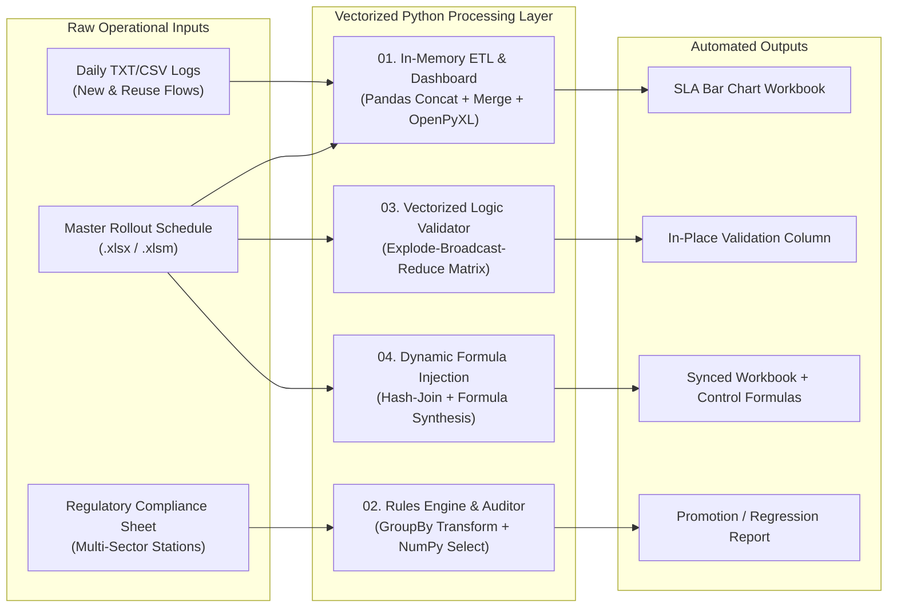

# Architecture & System Design Trade-Offs: Telecom DataOps Suite

This document outlines the engineering decisions, algorithmic complexity improvements, and architectural trade-offs across the four enterprise Data Operations and Automation pipelines refactored from legacy spreadsheet workflows into vectorized Python systems.

## System Overview

---

## Core Design Trade-Offs

### 1. In-Memory Processing (Pandas / NumPy) vs. Relational Database (PostgreSQL / SQLite)
- **Choice:** In-memory `pandas.DataFrame` and NumPy arrays for batch sizes of $10^4$ to $10^6$ rows.
- **Why:** Operational deployments run ad-hoc on analyst workstations or inside Excel workbooks via `xlwings`. Avoiding external database provisioning, connection pooling, and schema migrations eliminates operational friction while processing typical telecom rollout batches (< 500k rows) in sub-second RAM operations via Pandas' C/Cython backend.
- **When to Revisit:** If daily raw logs exceed available workstation RAM (> 2–4 GB) or require concurrent multi-user ACID writes, migrate the staging layer to DuckDB or PostgreSQL while preserving the vectorized transformation contract.

### 2. Algebraic Vectorization vs. Legacy VBA / Row Iteration (`iterrows`)
- **Choice:** Replaced Excel row-by-row VBA loops and Python `df.iterrows()` / `df.apply(..., axis=1)` with NumPy boolean masking (`np.where`, `np.select`), `groupby().transform('all')`, and `Series.str.split().explode()` + `.groupby(level=0).all()`.
- **Why:** Row-by-row COM/Excel object access incurs massive IPC overhead ($O(N)$ cross-process calls) and frequently freezes desktop spreadsheets. Reading ranges in bulk into NumPy/Pandas and writing back vectorized arrays reduces complexity from $O(N \times \text{COM\_latency})$ to vectorized C-level array passes ($O(N)$).

### 3. Hash-Set Filtering vs. In-Place `Row.Delete`
- **Choice:** Build an $O(1)$ lookup set (`Series.isin(valid_keys)`) in memory and bulk-emit the matching slice rather than deleting unmatched rows sequentially in Excel.
- **Why:** Deleting rows inside a workbook triggers layout recalculation and shifts memory offsets on every iteration ($O(N^2)$ worst-case UI work). Filtering in RAM and pasting a contiguous block executes in milliseconds.

### 4. Dynamic Excel Formula Injection vs. Hardcoded Static Aggregates
- **Choice:** Synchronize raw rows via Python and inject live Excel formulas (`=COUNTIF(...)`, `=XLOOKUP(...)`) sized dynamically to the filtered row count.
- **Why:** Downstream operational coordinators continue editing live tracking sheets in Excel after the Python sync completes. Preserving live Excel formulas on summary columns ensures real-time reactivity when humans update row status later in the day.

### 5. Dual-Mode Execution (CLI / Headless + Optional `xlwings` Bridge)
- **Choice:** Pure Python/Pandas core functions decoupled from Excel COM hooks, with thin `xlwings` wrappers gated behind lazy imports.
- **Why:** Guarantees 100% deterministic unit testing (`pytest`) on Linux/Windows CI runners without requiring a live Microsoft Excel installation, while still supporting one-click macro triggers on Windows desktops.
