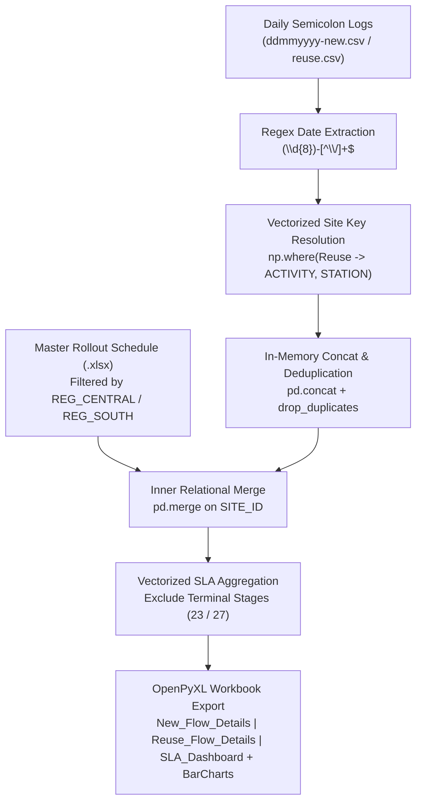

# In-Memory ETL Pipeline & CLI SLA Dashboard

## Problem Statement
Daily telecom network deployment operations produce high-volume, semicolon-delimited `.txt`/`.csv` status logs split across **New** and **Reuse** engineering workflows. Historically, analysts imported these logs manually into heavy macro-enabled workbooks (`QueryTables`), manually typed snapshot dates, cross-referenced regional schedules with fragile lookups, and waited minutes for Excel recalculations—frequently crashing the desktop client on multi-day accumulations.

## Solution & System Architecture
This pipeline shifts ingestion, deduplication, relational joining, and SLA computation completely into **in-memory RAM** using Pandas and NumPy, leaving Excel purely as a clean visualization layer rendered via OpenPyXL.



## Key Engineering Highlights
- **Zero Manual Date Input:** `extract_date_from_filename()` automatically parses the `ddmmyyyy-` timestamp embedded in raw daily filenames.
- **Vectorized Flow Normalization:** Resolves `SITE_ID` dynamically across heterogeneous schemas (`ACTIVITY` for *Reuse* flows; `STATION` with `ACTIVITY` fallback for *New* flows) via `numpy.where` in $O(N)$ time.
- **Business-Accurate Cycle SLA:** Groups dwell metrics by `(FLOW_TYPE, STAGE_NAME)` and excludes terminal administrative close-out stages (`23 - Final Site Acceptance` for New; `27 - Final Element Acceptance` for Reuse) when summing total active rollout cycle duration.
- **Automated Chart Generation:** Emits `New_Flow_Details`, `Reuse_Flow_Details`, and `SLA_Dashboard` worksheets with native Excel `BarChart` objects anchored automatically to computed ranges.

## Tech Stack
- **Python 3.10+**
- **Pandas & NumPy** (In-memory ETL, deduplication, relational merges, vectorized aggregations)
- **OpenPyXL** (Headless `.xlsx` serialization & native `BarChart` synthesis)
- **Pytest** (Deterministic unit and pipeline verification)

## Quickstart (Mock Data)
```bash
python data/mock/generate_mock_data.py
python -m src.01_in_memory_etl_dashboard.pipeline \
  --log New=data/mock/23112026-new_flow.csv \
  --log Reuse=data/mock/23112026-reuse_flow.csv \
  --schedule data/mock/master_rollout_schedule.xlsx \
  --sites data/mock/target_sites.csv \
  --output data/output/consolidated_sla_dashboard.xlsx
```
