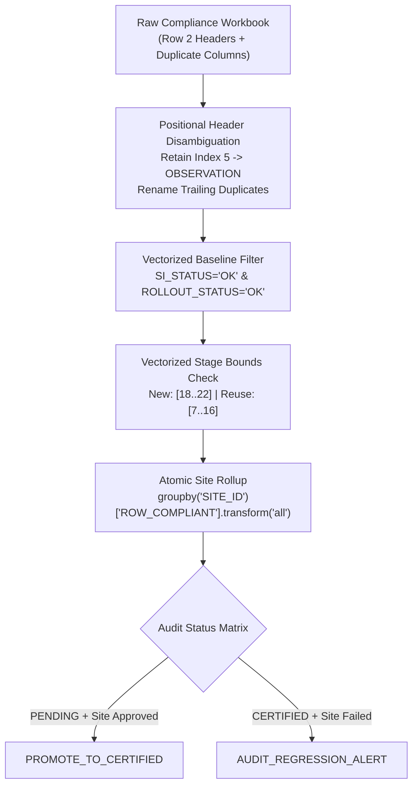

# Database Auditing & Business Rules Engine

## Problem Statement
Regulatory compliance teams must continuously determine which telecom sites satisfy every operational prerequisite to be promoted to `CERTIFIED` status, while simultaneously detecting regressions in previously certified stations whose underlying rollout metrics reverted out of compliance. Manual filtering in large multi-sector spreadsheets was error-prone due to:
1. Duplicate header columns (`OBSERVATION` appearing in both operational notes at Column F and trailing metadata columns), breaking standard column lookups.
2. Multi-sector station dependencies—where promoting a single passing sector while a sibling sector on the same `SITE_ID` remains non-compliant causes audit rejections.

## Solution & System Architecture
This engine executes positional header disambiguation, vectorized stage validation, and atomic site-level rollups inside Pandas/NumPy in a single pass—supporting both headless CLI/batch execution and optional live `xlwings` Excel triggers.



## Key Engineering Highlights
- **Zero Row-Level Python Loops:** Refactored row-wise `.apply(axis=1)` checks into vectorized Pandas string extraction (`.str.extract`), integer range tests (`.between()`), and NumPy conditional branching (`np.where`).
- **Transactional Site Integrity:** Using `groupby("SITE_ID")["ROW_COMPLIANT"].transform("all")`, if a station has 4 sectors and 1 fails validation, all 4 rows for that `SITE_ID` are atomically held back or flagged for regression review.
- **Headless & Desktop Dual-Mode:** Core logic is completely decoupled from COM bindings for deterministic `pytest` runs, with an optional `run_xlwings_macro()` hook for one-click Excel execution.

## Tech Stack
- **Python 3.10+**
- **Pandas & NumPy** (Vectorized filtering, regex parsing, `groupby().transform()`, `np.where`)
- **OpenPyXL / xlwings** (Headless batch `.xlsx` generation & optional Excel COM integration)
- **Pytest** (Unit testing for duplicate columns, atomic site rollbacks, and regression alerts)

## Quickstart (Mock Data)
```bash
python data/mock/generate_mock_data.py
python -m src.02_rules_engine_auditor.auditor \
  --input data/mock/compliance_audit_workbook.xlsx \
  --output data/output/compliance_audit_report.xlsx \
  --sheet COMPLIANCE_BASE \
  --header-row 1
```
