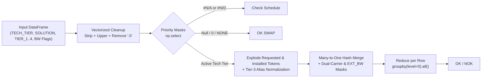

# Vectorized Logic Validator (Legacy Macro Refactoring)

## Problem Statement
Cross-checking planned RF/network solutions (`SOLUTION`, slash-delimited) against installed station capacities (`TIER_1` through `TIER_4`, underscore-delimited) along with carrier-specific dual-bandwidth rules (`ALPHA` / `BETA`) and extension flags (`EXT_BW`) previously relied on freezing Excel VBA macros and row-by-row Python iteration (`df.iterrows()`). On multi-thousand-row deployment spreadsheets, row-wise string splitting and COM writes stalled analyst workstations.

## Solution & System Architecture
This refactor replaces row iteration with a **100% vectorized Explode-Merge-Reduce pipeline** in Pandas and NumPy, executing token normalization, carrier-matrix checks, and status priority assignment in pure C-level array passes ($O(N)$).



## Algorithmic Complexity & Vectorization
- **Before (Legacy VBA / `iterrows()`):** Python loop overhead per row × inner loop over requested tokens × COM cell reads/writes.
- **After (Explode-Merge-Reduce):**
  1. Split and explode requested (`SOLUTION`) and installed (`TIER_*`) token lists into flat columnar Series.
  2. Apply Tier-3 alias mapping (`LOWA -> LOW`, `HIGHA/HIGHB -> HIGH`, `MIDC -> MID`) vectorially.
  3. Match requested tokens against installed tokens via `pd.merge(..., validate="many_to_one")` while evaluating `BW_DUAL_ACTIVITY` (`ALPHA`/`BETA`) and `BW_EXT_ACTIVITY` (`EXT_BW` -> `MIDEXT`) via vectorized NumPy bitmasks.
  4. Reduce token matches back to row granularity with `.groupby(level=0).all()`.

## Tech Stack
- **Python 3.10+**
- **Pandas & NumPy** (Explode, hash merge, vectorized regex/string ops, `np.select`)
- **OpenPyXL / xlwings** (Column-level batch injection into spreadsheets)
- **Pytest** (Comprehensive rule matrix & edge-case tests)

## Quickstart (Mock Data)
```bash
python data/mock/generate_mock_data.py
python -m src.03_vectorized_logic_validator.validator \
  --input data/mock/frequency_validation_workbook.xlsx \
  --output data/output/frequency_validation_checked.xlsx \
  --header-row 1
```
