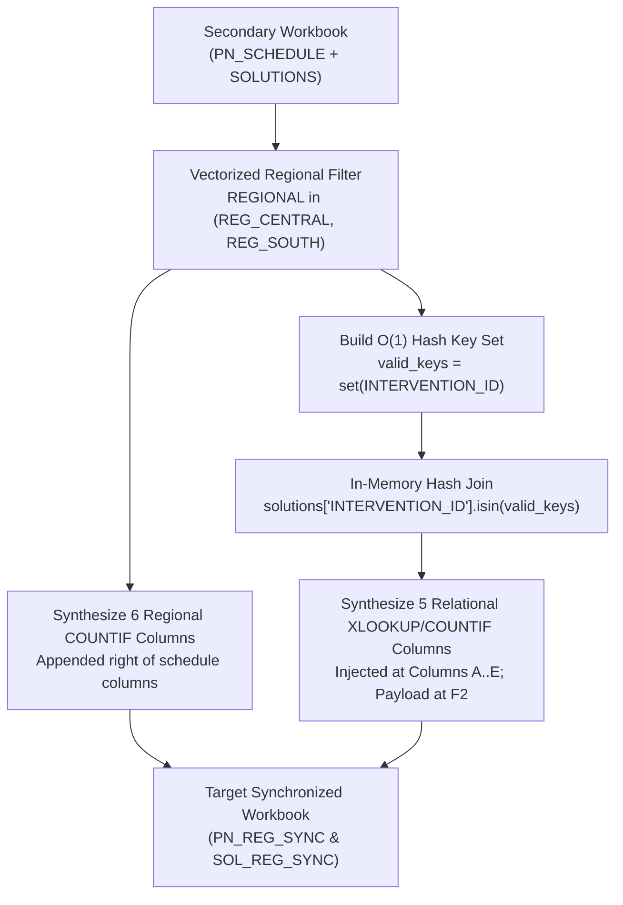

# Dynamic Formula Injection & Data Synchronization

## Problem Statement
Synchronizing multi-regional rollout schedules (`PN_SCHEDULE`) with detailed technical solution tables (`SOLUTIONS`) traditionally involved opening massive multi-sheet workbooks, applying UI filters, copying visible cells, and executing sequential row deletions on unmatched rows—an $O(N^2)$ UI bottleneck that froze Excel while leaving cross-sheet control formulas broken or misaligned whenever row counts changed.

## Solution & System Architecture
This pipeline performs regional filtering and relational key matching **in-memory via $O(N)$ hash-set joins**, then serializes clean blocks alongside dynamically dimensioned Excel control formulas (`=COUNTIF(...)` and `=XLOOKUP(...)`) calibrated precisely to the output row count.



## Key Engineering Highlights
- **Zero Slow `Row.Delete` Operations:** Filters `SOLUTIONS` entirely in RAM via hash-set membership (`Series.isin(valid_keys)`), avoiding Excel row-shift recalculation storms.
- **Dynamic Formula Dimensioning:** `build_schedule_control_formulas()` and `build_solution_relational_formulas()` generate exact row-indexed `=COUNTIF` and `=XLOOKUP` formulas matching rows `2..N+1`, keeping downstream spreadsheet trackers live and reactive for human operators.
- **Schema Preservation:** Places the relational index formulas in `A..E` while aligning raw synchronized payload cleanly starting at Column `F` (`F1` header / `F2` data).

## Tech Stack
- **Python 3.10+**
- **Pandas** (Regional boolean masking, hash-set relational filtering, vectorized formula column synthesis)
- **OpenPyXL / xlwings** (Dynamic coordinate injection & optional live Excel integration)
- **Pytest** (Validation of regional filters, hash joins, and exact formula coordinate injection)

## Quickstart (Mock Data)
```bash
python data/mock/generate_mock_data.py
python -m src.04_dynamic_formula_injection.synchronizer \
  --source data/mock/secondary_rollout_source.xlsx \
  --output data/output/synchronized_rollout_control.xlsx \
  --regions REG_CENTRAL REG_SOUTH
```
