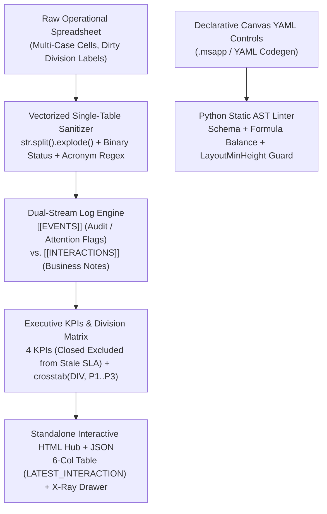

# Operational Data Pipeline, Dual-Stream Log Engine & Declarative UI Linter

## Problem Statement & Architectural Pivot Case Study
Originally designed as a three-list relational data model (`Cases`, `Events`, `Quality_Anomalies`) feeding a low-code frontend, real-world telemetry traces revealed two structural bottlenecks:
1. **The $N+1$ Query Bottleneck:** Every visible row in the analytical table triggered repeated filter lookups across the 429-item events list while hitting non-delegable connector caps (`StartsWith`, `Distinct`, `CountRows`).
2. **Manual Low-Code Fragility:** Maintaining 200+ responsive layout controls and Power Fx formulas manually in a web studio introduced silent quote/parenthesis typos and flexbox `LayoutMinHeight` clipping regressions.

## Solution & System Architecture
To eliminate $N+1$ lookups and deliver an enterprise-grade operational dashboard, the platform pivoted to a **Denormalized Single-Table Architecture** backed by a **Vectorized Dual-Stream ETL Pipeline** and a **Python Static AST Linter for Declarative YAML UI Trees**.



## Key Engineering Highlights
- **Single-Table Denormalization:** Consolidates operational tracking into one clean schema while preserving multi-case explosion (`.str.split(r"[,;]\s*").explode()`), strict `1`/`2`/`3` priority normalization, two-state lifecycle (`In Progress` / `Closed`), and `ESCALATED_TO_BOARD` detection.
- **Dual-Stream Log Separation (`[[EVENTS]]` vs. `[[INTERACTIONS]]`):** Prevents automated system logs (e.g., priority updates or external `⚑ Attention Request` triggers) from overwriting executive follow-up notes in the summary table's `LATEST_INTERACTION` column.
- **Stale SLA Precision:** Excludes `Closed` cases from `stale_10d_count` and renders `[Closed]` row badges alongside the dynamic active/closed breakdown.
- **Static AST Linter (`yaml_linter.py`):** Validates declarative Power Apps YAML trees before studio import—catching missing `=` prefixes, unbalanced Power Fx parentheses/quotes, plain-scalar colon hazards, duplicate control IDs, and rigid `LayoutMinHeight` container clipping risks.

## Tech Stack
- **Python 3.10+**
- **Pandas & NumPy** (Vectorized string explosion, regex extraction, `pd.crosstab`, zero `.iterrows()` / `.apply()`)
- **PyYAML** (Static AST parsing & formula balance linting for declarative UI YAML)
- **HTML5 / CSS3 / Vanilla JS** (Zero-dependency interactive dashboard export with slide-over X-Ray drawer)
- **Pytest** (Verification of ETL rules, dual-stream separation, YAML linter assertions, and LGPD sanitization)

## Quickstart (Mock Data)
```bash
python data/mock/generate_mock_data.py
python -m src.05_operational_data_pipeline.pipeline \
  --input data/mock/single_table_operations_tracker.xlsx \
  --output-html data/output/operations_intelligence_hub.html \
  --output-json data/output/single_table_cases.json \
  --ref-date 2026-11-23
python -m src.05_operational_data_pipeline.yaml_linter \
  --files data/mock/sample_declarative_ui.yaml
```
